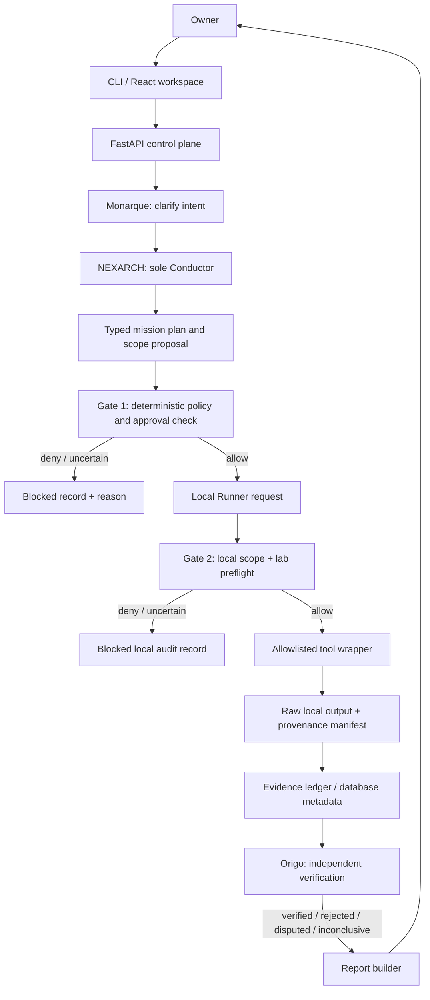

# Sentra Architecture

**Status:** design proposal only. Runtime behavior must later be proven by tests.

## 1. Core separation

Sentra has a control plane and a local execution plane. They may both run on the same laptop during early development, but they remain separate components and trust boundaries.

| Component | Initial location | Responsibility | Forbidden authority |
|---|---|---|---|
| React workspace | Local browser; optional hosted UI later | Mission editing, approval review, progress, evidence/report views | Cannot authorize or execute by itself |
| FastAPI control plane | Local first; optional Render staging later | API, owner identity, mission state, audit, Gate 1, metadata | Cannot connect directly to lab targets |
| PostgreSQL | Local first; later separately reviewed hosted database if chosen | Durable missions, scope/approval versions, audit, evidence metadata, jobs | Does not make a tool safe simply because a row exists |
| NEXARCH Conductor | Backend workflow service | One mission plan and task coordination | Cannot self-approve, change scope, or certify findings |
| ERGOUSIARCH Gate services | Deterministic modules in control plane and Runner | Scope/policy/approval validation and decision reasons | No prompt-based overrides |
| CLI | Owner's machine | Draft/validate/approve missions, preflight and query reports | No bypass around either Gate |
| Local Runner | Owner's machine only | Polls or receives bounded local jobs; runs exact wrappers | No general shell, public scanning, or hosted inbound control |
| Local Gate | Inside Runner process and local policy package | Re-check scope, local environment, expiry, wrapper args, limits and kill switch before every run | Cannot trust a control-plane “allowed” result alone |
| Evidence store | Local filesystem by default | Raw artifacts, manifests and reports | No overwrite of prior evidence records |
| Origo verifier | Separate verification component/process boundary where practical | Independently evaluates evidence and allowed re-tests | Cannot certify its own output or substitute narrative for evidence |

## 2. Mission flow



This is an architectural proposal. It does not say any component is currently running.

## 3. Authority hierarchy

1. The owner decides the objective and explicitly approves the bounded mission.
2. Written scope defines targets, exclusions, permitted operation identifiers, and limits.
3. Deterministic policy and approval services decide whether the proposed action meets the written rules.
4. Gate 1 validates mission state, approval binding, policy and requested wrapper.
5. Gate 2 independently validates local scope, local environment and execution conditions.
6. The wrapper can invoke only a pinned/known tool using typed allowlisted arguments.
7. Evidence records what actually happened; Origo assesses the claim separately.

A model's output, UI label, API response field from a single Gate, or agent's assurance is never the security boundary.

## 4. Mission and scope contract

Each mission should persist at least:

- `mission_id`, `owner_id`, creation time, purpose, and requested outcome.
- Versioned scope file and cryptographic scope digest.
- Explicit in-scope target identifiers; exclusions; resolved addresses; expected lab interface/network.
- Allowed wrapper IDs and parameter bounds; forbidden actions; resource/time/request/concurrency limits.
- Approval record bound to this mission, its scope digest, policy version, allowed operations, approver, and expiry.
- Baseline reference, success criteria, stop conditions, cancellation semantics, and report requirements.
- Tool, wrapper, Runner, and policy versions used on execution.
- Current state, previous transition, state-transition reason, timestamps and audit references.

Mission state stored in PostgreSQL is authoritative for lifecycle tracking, but the local Gate also requires a locally controlled scope and current lab preflight.

## 5. Gate decision order

The first failed check denies the action and records a stable reason code. Run the relevant checks again at Gate 2 using the local policy/scope source. Missing or malformed data means deny.

1. Mission exists, is in an executable state, and has a current, unrevoked owner approval.
2. The approved scope digest still matches the mission and local scope record.
3. Tier and environment allow the action; T4 remains denied.
4. Wrapper/action ID is explicitly allowed and not prohibited.
5. Target hostname has been resolved and the resulting IP/port is inside scope and outside exclusions.
6. Requested time, rate, concurrency, output, byte and target limits are valid and do not exceed policy ceilings.
7. Required baseline, tool-version and local environment checks pass.
8. No stop/cancel signal or kill-switch marker is present.
9. At Gate 2, the local scope file, local policy version, expected lab interface and route must independently match.

## 6. Example mission contract (illustrative only)

The example defines a bounded lab inventory request. It is a schema illustration, not an active scope, authorization, or runnable command. A real mission must be generated and reviewed through the approved format and bind approval to a digest of the exact scope.

```yaml
mission_id: m-example
objective: "Inventory selected services on the designated training VM"
mode: lab
tier: T3
scope:
  in_scope: ["192.168.56.20/32"]
  exclusions: ["192.168.56.1"]
  ports: ["80", "443"]
allowed_actions: ["port_service_inventory"]
prohibited_actions: ["exploit", "brute_force", "denial_of_service", "destructive_change"]
limits:
  max_runtime_seconds: 120
  max_requests_per_second: 2
  max_concurrency: 1
  max_output_bytes: 10000000
stop_conditions: ["local STOP signal", "out-of-scope resolution", "lab route mismatch"]
verification: "distinct bounded service check where applicable"
approval:
  approver: "owner"
  scope_sha256: "computed-digest-required"
  expires_at: "owner-selected-UTC-time"
```

Changing the scope or any approval-bound field invalidates the previous approval and requires renewed review. The local Gate must compare the approved digest with the locally controlled scope.

## 7. Gate result record and re-checks

A Gate decision is typed and auditable: `ALLOW`, `DENY`, or `NEEDS_OWNER_REVIEW`; a missing/unavailable check is not an allow. Record mission/task/action identifiers, scope and approval digests, policy version, target resolution, environment-check version, decision reason, and time. Gate 2 must return a denial if it cannot independently verify the required facts.

Checks occur when a mission is approved, when it is dispatched, and immediately before each wrapper call. Re-check approval expiry and stop conditions mid-run when feasible. A redirect, DNS change, target change, wrapper upgrade, policy change, or scope digest mismatch can invalidate authorization.

## 8. Runner contract

The control plane sends a typed, bounded work request, not a free-form command. The local Runner:

1. Reads the request and local scope without treating request content as trusted.
2. Validates the mission ID, owner, policy/scope digests, expiry, allowed action, limits and local kill switch.
3. Checks the target resolves to the approved lab target and that the route/interface is the expected isolated lab path.
4. Calls a fixed wrapper with typed parameters; the wrapper uses an argument list and never runs a shell string.
5. Caps duration, output, connections and concurrency; handles redirects and DNS safely for HTTP actions.
6. Stops new work on cancellation or the kill switch and attempts to terminate the wrapper process group.
7. Persists raw output locally, finalizes the manifest, and reports status—not authority—to the control plane.

The Runner must not open an inbound port to the internet. If remote coordination is later supported, outbound polling is preferred. No remote command channel can bypass the local Gate.

## 9. Authentication and single-user workspace

“One user” reduces product complexity but does not eliminate web security needs. The backend still authenticates the owner and checks owner identity on each resource access. Public registration remains disabled. Owner creation is a local, deliberate bootstrap flow that must not be exposed as an unauthenticated production endpoint.

Browser session design: opaque random session ID, server-side expiry/revocation, rotation after login and sensitive changes, HTTP-only cookie, Secure in HTTPS, appropriate SameSite, narrow path/domain, and CSRF defense for state-changing cookie-authenticated requests. Validate `Origin`/`Referer` as a supplemental control, not the only CSRF check. Require MFA (for example, TOTP) before making the control plane reachable from the internet. CLI credentials are separate, revocable, least-privilege, and never returned to frontend JavaScript. Use password hashing such as Argon2id if local password auth is selected. Rate-limit login and audit failures.

## 10. Persistence and evidence boundary

PostgreSQL records should include owner, sessions, revocable CLI tokens, missions, scope and approval versions, task executions, jobs/attempts, baselines, evidence metadata, findings, verification results, reports, and audit events. It stores operational metadata and references. Raw scan outputs, logs, packets, response bodies, and screenshots may contain secrets or personal information and stay on the local machine by default. Hosted deployments should not upload raw artifacts without an explicit data-transfer decision and redaction policy. The evidence model and its tamper-evident limitations are described in `EVIDENCE.md`.

## 11. Workflow and retries

Start with a small PostgreSQL-backed state machine and job leases, not a workflow platform dependency. Retry only operations declared safe and idempotent, and always re-check scope/approval before retry. If the Runner or control plane disappears, the state becomes interrupted/unknown until reconciled with local evidence. Never infer success from a missing response.

## 12. Required architecture tests

Test direct API calls that skip the UI; cross-owner IDs even though multi-user support is absent; CSRF rejection; expired/replayed approval; Gate 1 allow vs Gate 2 deny; scope-digest mismatch; DNS/redirect escape; wrapper argument injection; kill switch; partial output; evidence hash mismatch; verifier failure; database outage; cancellation race; and proof that the hosted control plane cannot reach the lab network.
